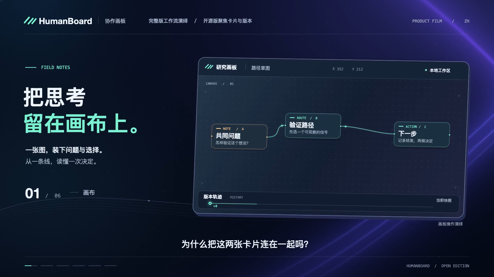
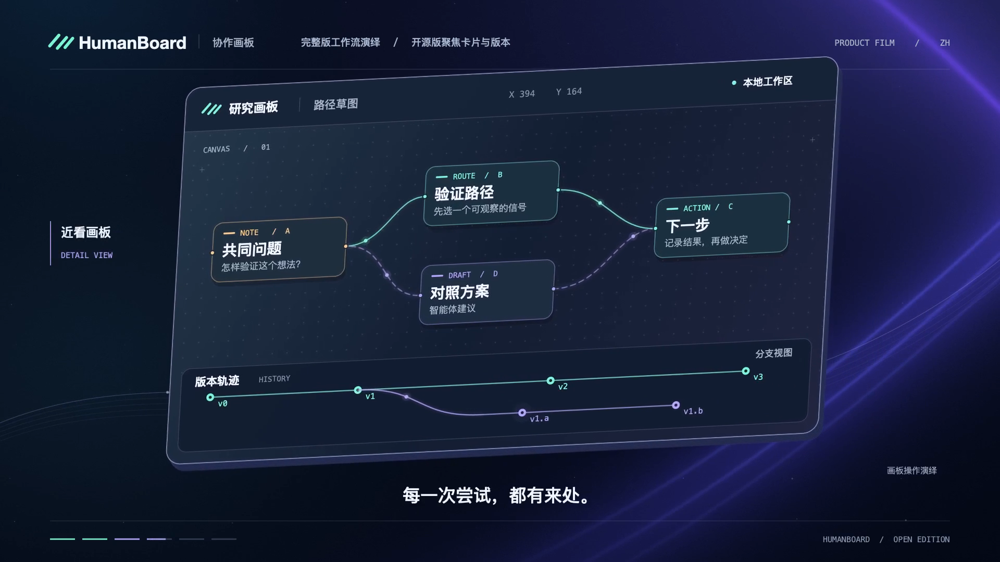
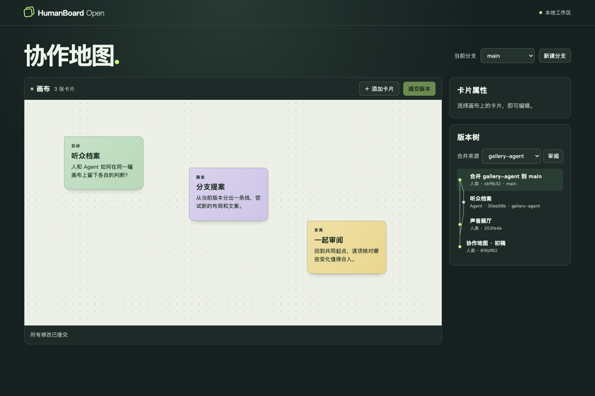
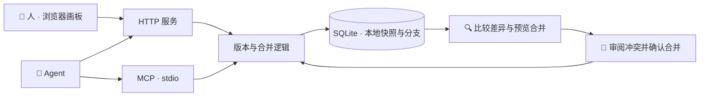

<div align="center">

# HumanBoard Open

### 让人的灵感和 Agent 的提案，在同一张画板上相遇。

**一张可以分支、提交、审阅和合并的中文画板。**

[](https://nodejs.org/)
[](https://www.sqlite.org/)
[](#agent-接入)
[](LICENSE)
<br>
[](https://raymortwinkle.github.io/HumanBoard-Open/)
[](https://raymortwinkle.github.io/HumanBoard-Open/media/promo.mp4)
[](https://github.com/RayMorTwinkle/HumanBoard-Open)

[✨ 在线交互体验站](https://raymortwinkle.github.io/HumanBoard-Open/) · [🎬 观看中文宣传片](https://raymortwinkle.github.io/HumanBoard-Open/media/promo.mp4) · [🚀 3 分钟上手](#快速上手) · [📊 实测对比](#实测对比) · [🏗️ 核心架构](#核心架构)

</div>

<div align="center">

[](https://raymortwinkle.github.io/HumanBoard-Open/media/promo.mp4)

**▶ 点击封面观看中文宣传片** · [✨ 打开在线展示站](https://raymortwinkle.github.io/HumanBoard-Open/)

<video controls width="960" poster="docs/media/poster.jpg">
  <source src="https://raymortwinkle.github.io/HumanBoard-Open/media/promo.mp4" type="video/mp4">
  浏览器不支持内嵌播放，请使用上方视频链接。
</video>

<sub>GitHub 可能不显示内嵌播放器；点击封面或视频链接即可观看。</sub>

</div>

<table>
  <tr>
    <td width="50%" align="center"><br><b>🌿 每一次尝试，都有来处</b><br><sub>从同一份想法出发，探索不同方向</sub></td>
    <td width="50%" align="center"><br><b>🤝 把协作留在画板上</b><br><sub>让人的判断与 Agent 的提案相遇</sub></td>
  </tr>
</table>

> 🎬 以上是宣传片中的工作流视觉演绎。**Open 版聚焦本地卡片编辑、版本分支与合并审阅**；原项目的自由画布、笔迹、资产、模型配置与部署服务不包含在本仓库中。

## 💡 为什么做它？

你在画板上整理思路，Agent 也给出了一个好点子——可两边都改了同一张卡片，到底该留下谁的版本？🤔

HumanBoard Open 给人和 Agent 一份共同的起点：各自从快照出发，分支尝试，再把差异摆出来审阅。遇到冲突时，原值和双方修改都看得见，决定权留给你。✨

## ✨ 核心亮点

- 🎨 **动手就能整理**：在浏览器里编辑、移动卡片，把眼前的想法放到画板上。
- 🌱 **放心分支探索**：从已有版本另开分支，让 Agent 提案和你的主线各自往前走。
- 🔍 **看清每一次变化**：比较版本差异；同一字段发生冲突时，对照祖先、目标和提案的值再选择。
- 🤝 **人和 Agent 共用一份版本**：浏览器通过 HTTP 操作，Agent 可通过 HTTP 或 MCP stdio 接入同一份本地存储。
- 🧩 **合并有迹可循**：不同内容的修改可以一起保留；分叉后合并会记录双亲，合适时也支持快进。
- 💾 **本地即可运行**：Node 内置 SQLite 保存版本，画板应用本身无需安装额外依赖。

<details>
<summary>🖼️ 看看开源版实际运行的画板</summary>



</details>

<a id="核心架构"></a>
## 🏗️ 工作原理

人和 Agent 从同一份快照出发；各自提交后，先预览差异与冲突，再决定是否合并。



每次提交都会核对读取时的版本头；如果分支已经前移，旧提交或旧合并预览不会悄悄覆盖新内容。

<a id="实测对比"></a>
## 📊 实测改善：Before vs After

下面是**原项目 Diagram → Scene 排版编译器**的固定输入实验，展示一次同步编译的耗时中位数。它和本仓库的本地卡片协作服务是两项独立工作，不能把这里的加速倍数当作 Open 版画板的性能表现。

| 固定输入 | Before | After | 耗时对比 |
| --- | ---: | ---: | ---: |
| 500 节点单链思维图 | 664.4132 ms | 2.1069 ms | 约 **315.4 倍** |
| 500 节点逻辑图，边逆序 | 11.9496 ms | 2.5296 ms | 约 **4.7 倍** |
| 120 节点双边思维图，带 119 个旧节点 | 1.2217 ms | 0.3912 ms | 约 **3.1 倍** |
| 12 节点小思维图 | 0.0650 ms | 0.0563 ms | 小输入对照 |

<details>
<summary>📏 展开查看测量方法与结论边界</summary>

- 同一进程中加载两版，在 Apple M1 Max、macOS arm64、Bun 1.3.13 环境下，每个场景每版预热 2 次、计时 10 次，并逐轮交换先后顺序。表中为首次记录的中位数；输入构造、模块加载和输出哈希不计入耗时。
- 独立复测的深链结果为 871.56 → 2.47 ms；小图差值方向翻转，**未观察到稳定的小图加速**。两轮均未锁定系统负载，也未采集真实用户输入分布。
- 四组计时样例的完整 Scene 摘要在两版间相同；报告还记录了固定种子、旧坐标与非法输入的兼容性检查。这些检查不能排除两版共有的缺陷。
- 未测量浏览器帧率、网络同步、并发吞吐、用户工作量或生产环境百分位，也没有模型成功率或偏好胜率。详见[评测报告及原始数据](docs/evals/refactor-1126-report.md)。

</details>

<a id="快速上手"></a>
## 🚀 3 分钟本地跑起来

准备 **Node.js 24**，然后在终端运行：

```sh
git clone https://github.com/RayMorTwinkle/HumanBoard-Open.git
cd HumanBoard-Open
npm start
```

打开 [http://localhost:4317](http://localhost:4317)，编辑并提交画板上的卡片。保持服务运行，再打开一个终端，在同一目录执行：

```sh
npm run demo
```

演练会从当前主线头创建一个 `agent-…` 分支，加入一张建议卡，并打印可在浏览器打开的审阅地址。主线不会被演练直接改动：回到主线继续编辑，再预览提案分支的合并，就能体验一次完整交接。

<a id="agent-接入"></a>
### 🤖 让 Agent 来试试

MCP 客户端可通过 stdio 启动 `src/mcp.mjs`。把下面的路径替换成你本机的仓库绝对路径：

```json
{
  "mcpServers": {
    "humanboard": {
      "command": "node",
      "args": ["/绝对路径/HumanBoard-Open/src/mcp.mjs"]
    }
  }
}
```

可以给 Agent 一句任务：

> 读取 main 的 head，从它创建 proposal 分支。在新分支补充「记录现场」的说明，保留其他卡片，提交后给我看差异。合入主线前等我审阅。

常用工具依次是 `board_state`、`board_branch`、`board_commit`、`board_diff`；读取历史快照用 `board_version`，预览和确认合并用 `board_merge`。HTTP 服务和 MCP 进程可独立启动，但要指向同一数据目录才能共享画板。

<details>
<summary>🛠️ HTTP 接口、数据目录与验证</summary>

HTTP 请求正文使用 `application/json`。提交需要完整卡片数组，漏掉已有卡片表示删除。

| 方法和路径 | 用途 |
| --- | --- |
| `GET /api/state?branch=main` | 读取分支头、卡片、分支列表与历史 |
| `GET /api/version?id=VERSION` | 读取版本快照 |
| `GET /api/diff?from=BASE&to=HEAD` | 比较版本之间的卡片变化 |
| `POST /api/branch` | 从指定版本创建分支：`name, from` |
| `POST /api/commit` | 提交完整卡片：`branch, base, cards, message, author` |
| `POST /api/merge` | 用 `target, source, targetHead, sourceHead, preview` 预览或确认合并，必要时传入 `resolutions` |

先用 `preview: true` 读取冲突，再带原来的双端 head 和 `preview: false` 确认。例如字段冲突可传 `{"id":"question","field":"title","use":"source"}`；整卡冲突使用 `$card`。分支已前移时返回 HTTP 409 和 `STALE_HEAD`，需要重新读取并审阅。

默认数据目录为 `.humanboard-open/`；可用 `HUMANBOARD_DIR` 指定独立目录，用 `PORT` 更换本机 HTTP 端口。HTTP 服务与 MCP 进程需使用相同的数据目录。工具调用和页面操作以本机使用者的权限执行，`author` 用于标记编辑来源。

运行回归检查：

```sh
npm test
```

</details>

## 📚 延伸阅读 & 许可

- ✨ [在线交互体验站](https://raymortwinkle.github.io/HumanBoard-Open/) · [中文宣传片](https://raymortwinkle.github.io/HumanBoard-Open/media/promo.mp4)
- 📊 [排版实验报告、复现方法与原始数据](docs/evals/refactor-1126-report.md)
- 🧭 [Ray 的个人主页](https://raymor.top)
- 📄 使用 [MIT 许可证](LICENSE)开源。

<div align="center">

**如果你也想让人和 Agent 一起把想法变得更清楚，欢迎给 HumanBoard Open 一颗 ⭐**

[回到顶部 ↑](#humanboard-open)

</div>
